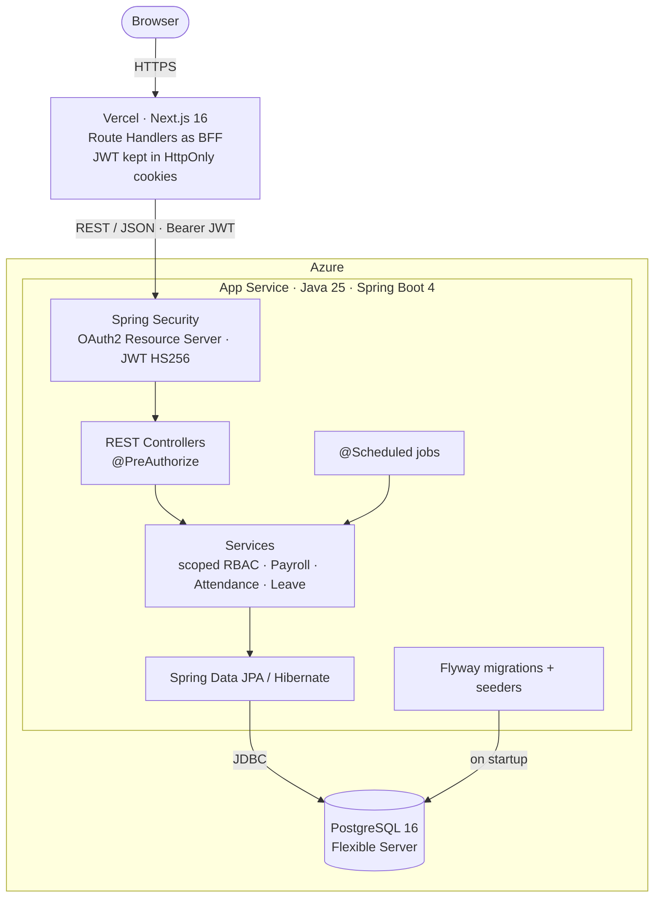

# HRM System

[](https://github.com/NguyenAlpha/HRM-system/actions/workflows/ci.yml)


**English** | [Tiếng Việt](README.vi.md)

A human resource management system for a company with multiple departments and branches: employee records,
organization structure, attendance, leave, and payroll with social insurance and personal income tax.

The core is a **Spring Boot REST API** with scope-based RBAC (self / department / location / company), a payroll
period state machine, and data integrity enforced in PostgreSQL. The Next.js web app is a companion frontend
that exercises the API end to end.

## Live demo

| | |
|---|---|
| Web app | https://hrm.nhatnguyenhuynh.com |
| API docs (Swagger UI) | https://hrm-api-94ee02.azurewebsites.net/swagger-ui/index.html |

Sign in at `/login` with one of the seeded demo accounts. The password is `password` for all three:

| Username | Role | What you can try |
|---|---|---|
| `owner` | Company Owner | Everything in the company, including payroll and role grants |
| `hr` | HR Manager (company-wide) | Employees, leave approvals, attendance, reports |
| `employee` | Employee (self) | Own profile, leave requests, timesheet, payslips |

## Backend highlights

- **Refresh token rotation with reuse detection.** Only a SHA-256 hash of each refresh token is stored. A refresh
  revokes the old token with a conditional `UPDATE … WHERE revoked_at IS NULL`, so only one of two concurrent
  requests wins. Presenting an already revoked token revokes every session of that account.
  → [`RefreshTokenService.rotate`](api/src/main/java/com/htttdn/hrm/service/RefreshTokenService.java)
- **Data scope on top of RBAC.** A role is granted with a scope (`SELF`, `ORG_UNIT`, `LOCATION`, `COMPANY`) and a
  validity period, and single permissions can be granted or revoked per assignment. The effective scope expands
  the org tree and becomes a JPA `Specification` applied to the query. Reports check former employees against the
  scope on their last working day.
  → [`EmployeeAccessScopeService`](api/src/main/java/com/htttdn/hrm/service/EmployeeAccessScopeService.java),
  [`AccountAuthorizationService`](api/src/main/java/com/htttdn/hrm/service/AccountAuthorizationService.java)
- **Payroll that stays correct under retroactive changes.** Periods move through
  `DRAFT → CALCULATED → APPROVED → PAID → LOCKED` and are locked with `PESSIMISTIC_WRITE` while being calculated.
  A back-dated change to salary, attendance, holidays, insurance or tax rules resets affected `CALCULATED` periods
  to `DRAFT` and is rejected for approved, paid or locked periods.
  → [`PayrollService.calculate`](api/src/main/java/com/htttdn/hrm/service/PayrollService.java),
  [`PayrollDeductionsService`](api/src/main/java/com/htttdn/hrm/service/PayrollDeductionsService.java)
- **Overlapping periods are rejected by the database.** Salary history, primary assignments, allowance rules, tax
  and insurance rules and approved leave use `EXCLUDE USING GIST` constraints on date ranges (`btree_gist`), so
  two concurrent transactions cannot write overlapping records.
  → [`V4__employment_and_salary.sql`](api/src/main/resources/db/migration/V4__employment_and_salary.sql)
- **Tax rules as data.** Progressive personal income tax brackets and insurance rates live in the database with
  validity periods. The calculation rejects brackets with gaps or overlaps before computing with `BigDecimal`.
  → [`PayrollDeductionsService.progressiveTax`](api/src/main/java/com/htttdn/hrm/service/PayrollDeductionsService.java)

## Architecture



- The browser never holds a JWT. Next.js Route Handlers keep the access and refresh tokens in `HttpOnly` cookies
  and call the API server-side with a `Bearer` header.
- There are two portals on one API: **HRM Workspace** (`/login`) for business users and **Admin Console**
  (`/admin/login`) for `SYSTEM_ADMIN`, with separate cookies.
- The API is layered as controller → service → repository. Every domain service asks the access-control
  component for the caller's permissions and data scope.
- Two scheduled jobs run daily (Asia/Ho_Chi_Minh): 00:05 prepares the month's timesheets and 00:10 completes due
  resignations. Both also run once at startup.

## Features

- **Authentication:** JWT access token (15 min) and refresh token (30 days) with rotation; one-time account
  activation links; separate admin and business portals.
- **Access control:** permission-based roles granted with a scope and validity period, per-permission overrides, role request and approval workflow, and a guard so only a Company Owner can change another Company
  Owner's access.
- **Organization and employees:** org unit and work location trees, job positions, employee profiles, assignment
  and salary history, sensitive data behind a separate permission.
- **Leave:** annual leave of 12 days a year prorated by months worked, approvals, overlap checks, leave
  notifications; resignation requests.
- **Attendance:** monthly timesheets, work shifts, company holidays, punch reconciliation by HR.
- **Payroll:** position and seniority allowances, social / health / unemployment insurance, progressive personal
  income tax with dependents, adjustments, payslips, XLSX export.
- **Reports:** workforce, turnover, monthly summary, attendance, leave and payroll, filtered by the caller's scope.

## Tech stack

| Area | Technologies |
|---|---|
| Backend | Java 25, Spring Boot 4.0 (Spring Framework 7), Spring Security 7 + OAuth2 Resource Server, Spring Data JPA / Hibernate, Bean Validation, Flyway, springdoc-openapi 3.0, fastexcel, Lombok |
| Database | PostgreSQL 16 (33 tables, `btree_gist` exclusion constraints) |
| Frontend | Next.js 16 (App Router), React 19, TypeScript, Tailwind CSS 4, shadcn/ui + Base UI, React Hook Form + Zod, openapi-typescript |
| Infrastructure | Azure App Service + Azure Database for PostgreSQL Flexible Server, Vercel, Docker Compose for local PostgreSQL, GitHub Actions CI |

## Project structure

```text
HRM-system/
├── api/                          Spring Boot API
│   ├── src/main/java/com/htttdn/hrm/
│   │   ├── config/               Security, OpenAPI, startup seeders
│   │   ├── controller/           REST controllers
│   │   ├── service/              Business logic and scheduled jobs
│   │   ├── repository/           Spring Data JPA repositories
│   │   ├── entity/               JPA entities
│   │   ├── security/             JWT, current account, error responses
│   │   └── exception/            Exceptions and global handler
│   ├── src/main/resources/
│   │   ├── db/migration/         Flyway migrations (V1–V10, one per domain)
│   │   └── seed/staff.json       Demo staff data
│   ├── scripts/                  Azure deployment and demo data scripts
│   └── docs/api/                 API reference per module
├── apps/web/                     Next.js frontend
├── docs/                         Setup, features, architecture, backups
└── docker-compose.yaml           Local PostgreSQL
```

## Getting started

Requirements: Java 25, Node.js 20.9+, npm 10+, Docker.

```bash
# 1. Database
docker compose up -d database

# 2. API (http://localhost:8080)
cd api
sh ./mvnw spring-boot:run          # Windows: ./mvnw.cmd spring-boot:run

# 3. Web (http://localhost:3000), in another terminal
cd apps/web
cp .env.example .env.local         # Windows: Copy-Item .env.example .env.local
npm ci
npm run dev
```

Flyway applies the migrations and the seeders load the company, RBAC, demo staff, attendance and past payroll
periods on first start. Locally you can sign in with the demo accounts above, or with `admin` / `Admin@123` at
`/admin/login`. These defaults are for development only; production sets `JWT_SECRET`, `DB_*`,
`ADMIN_SEED_PASSWORD`, `CORS_ALLOWED_ORIGINS` and `API_DOCS_ENABLED` through environment variables.

Swagger UI is available at http://localhost:8080/swagger-ui.html.

> A local database created before 2026-10-11 must be recreated once with `docker compose down -v`, because the
> migrations were consolidated into a new baseline.

## Testing

```bash
cd api
sh ./mvnw test                     # needs the PostgreSQL container running

cd ../apps/web
npm run lint
npm run typecheck                  # also fails if lib/api-schema.ts is stale against openapi.json
npm run build
```

Some integration tests assume a clean database. Point `DB_URL` at a separate test database instead of the one
holding your development data. CI runs the same steps on every push and pull request, with PostgreSQL as a
service container.

## Documentation

Detailed documentation is written in Vietnamese.

- [Setup and troubleshooting](docs/SETUP.md)
- [Feature inventory](docs/FEATURES.md)
- [Overview and architecture](docs/OVERVIEW.md)
- [Organization structure and permissions](docs/ORGANIZATION_STRUCTURE.md)
- [Source structure](docs/PROJECT_STRUCTURE.md)
- [API reference](api/docs/api/README.md), including [attendance](api/docs/api/ATTENDANCE.md) and [payroll](api/docs/api/PAYROLL.md)
- [Database backup and restore](docs/BACKUP.md)
- [Web app documentation](apps/web/docs/README.md)
