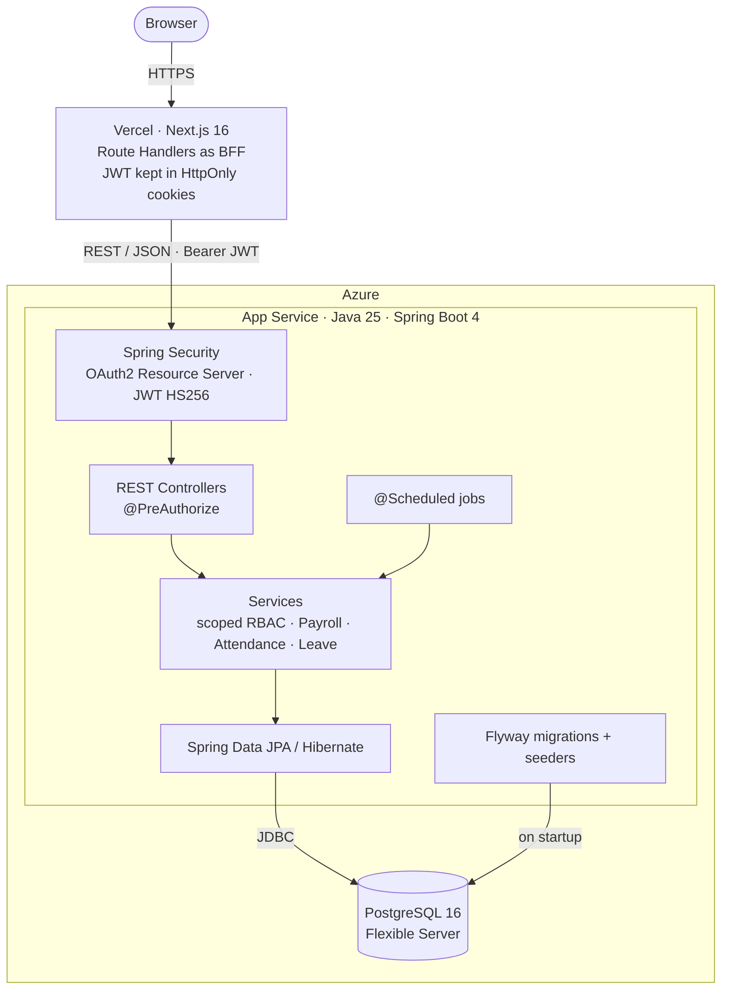

# HRM System

[](https://github.com/NguyenAlpha/HRM-system/actions/workflows/ci.yml)


[English](README.md) | **Tiếng Việt**

Hệ thống quản trị nhân sự cho doanh nghiệp có nhiều phòng ban và chi nhánh: hồ sơ nhân viên, cơ cấu tổ chức,
chấm công, nghỉ phép, tính lương kèm bảo hiểm và thuế thu nhập cá nhân.

Phần cốt lõi là **REST API Spring Boot**, có RBAC theo phạm vi dữ liệu (cá nhân / phòng ban / địa điểm / toàn
công ty), kỳ lương chạy theo state machine và ràng buộc toàn vẹn dữ liệu ngay trong PostgreSQL. Web Next.js là
frontend đi kèm để dùng thử API từ đầu đến cuối.

## Demo

| | |
|---|---|
| Web | https://hrm.nhatnguyenhuynh.com |
| Tài liệu API (Swagger UI) | https://hrm-api-94ee02.azurewebsites.net/swagger-ui/index.html |

Đăng nhập tại `/login` bằng một trong các tài khoản demo có sẵn trong seed. Cả ba đều dùng mật khẩu `password`:

| Username | Vai trò | Có thể thử |
|---|---|---|
| `owner` | Company Owner | Toàn bộ chức năng trong công ty, gồm tính lương và cấp quyền |
| `hr` | HR Manager (toàn công ty) | Nhân viên, duyệt đơn nghỉ, chấm công, báo cáo |
| `employee` | Nhân viên (chính mình) | Hồ sơ cá nhân, đơn nghỉ, bảng công, phiếu lương |

## Điểm nhấn backend

- **Refresh token rotation có phát hiện token bị dùng lại.** DB chỉ lưu SHA-256 hash của refresh token. Mỗi lần
  refresh, token cũ bị thu hồi bằng câu `UPDATE … WHERE revoked_at IS NULL` có điều kiện, nên khi hai request
  chạy đồng thời chỉ một request thắng. Gửi lại token đã bị thu hồi sẽ làm mọi phiên của account đó bị thu hồi.
  → [`RefreshTokenService.rotate`](api/src/main/java/com/htttdn/hrm/service/RefreshTokenService.java)
- **Phạm vi dữ liệu bên trên RBAC.** Role được gán kèm phạm vi (`SELF`, `ORG_UNIT`, `LOCATION`, `COMPANY`) và
  thời hạn hiệu lực; từng permission có thể được cấp thêm hoặc thu hồi trên từng lần gán. Phạm vi hiệu lực được
  mở rộng theo cây tổ chức rồi chuyển thành JPA `Specification` ghép vào query. Báo cáo kiểm tra nhân viên đã nghỉ
  theo phạm vi tại ngày làm việc cuối của họ.
  → [`EmployeeAccessScopeService`](api/src/main/java/com/htttdn/hrm/service/EmployeeAccessScopeService.java),
  [`AccountAuthorizationService`](api/src/main/java/com/htttdn/hrm/service/AccountAuthorizationService.java)
- **Kỳ lương vẫn đúng khi dữ liệu thay đổi hồi tố.** Kỳ lương đi qua các trạng thái
  `DRAFT → CALCULATED → APPROVED → PAID → LOCKED` và bị khóa `PESSIMISTIC_WRITE` khi đang tính. Thay đổi có hiệu lực
  lùi về quá khứ (lương, chấm công, ngày lễ, bảo hiểm, quy tắc thuế) đưa các kỳ `CALCULATED` bị ảnh hưởng về
  `DRAFT`, và bị từ chối nếu kỳ đã duyệt, đã trả hoặc đã khóa.
  → [`PayrollService.calculate`](api/src/main/java/com/htttdn/hrm/service/PayrollService.java),
  [`PayrollDeductionsService`](api/src/main/java/com/htttdn/hrm/service/PayrollDeductionsService.java)
- **Database tự chặn các khoảng thời gian chồng lấn.** Lịch sử lương, phân công chính, quy tắc phụ cấp, quy tắc
  thuế và bảo hiểm, đơn nghỉ đã duyệt đều có ràng buộc `EXCLUDE USING GIST` trên khoảng ngày (`btree_gist`), nên
  hai transaction đồng thời không thể ghi ra hai bản ghi chồng nhau.
  → [`V4__employment_and_salary.sql`](api/src/main/resources/db/migration/V4__employment_and_salary.sql)
- **Quy tắc thuế là dữ liệu.** Bậc thuế TNCN lũy tiến và tỉ lệ bảo hiểm được lưu trong DB theo khoảng hiệu lực.
  Hàm tính thuế từ chối bảng bậc bị hở hoặc chồng nhau trước khi tính bằng `BigDecimal`.
  → [`PayrollDeductionsService.progressiveTax`](api/src/main/java/com/htttdn/hrm/service/PayrollDeductionsService.java)

## Kiến trúc



- Trình duyệt không bao giờ giữ JWT. Route Handlers của Next.js giữ access token và refresh token trong cookie
  `HttpOnly`, rồi gọi API phía server kèm header `Bearer`.
- Một API phục vụ hai portal với cookie riêng: **HRM Workspace** (`/login`) cho người dùng nghiệp vụ và **Admin
  Console** (`/admin/login`) cho `SYSTEM_ADMIN`.
- API chia layer controller → service → repository. Mọi service nghiệp vụ đều hỏi thành phần kiểm soát truy cập
  để lấy quyền và phạm vi dữ liệu của người gọi.
- Hai job chạy hằng ngày (múi giờ Asia/Ho_Chi_Minh): 00:05 chuẩn bị bảng chấm công của tháng, 00:10 hoàn tất các
  đơn nghỉ việc đến hạn. Cả hai cũng chạy một lần khi ứng dụng khởi động.

## Tính năng

- **Xác thực:** access token JWT (15 phút) và refresh token (30 ngày) có xoay vòng; link kích hoạt tài khoản dùng
  một lần; tách portal quản trị và portal nghiệp vụ.
- **Phân quyền:** role gồm các permission, được gán kèm phạm vi và thời hạn; override từng permission; quy trình
  yêu cầu và duyệt cấp quyền; chỉ Company Owner mới đổi được quyền truy cập của Company Owner khác.
- **Tổ chức và nhân viên:** cây phòng ban và địa điểm làm việc, chức vụ, hồ sơ nhân viên, lịch sử phân công và
  lịch sử lương, dữ liệu nhạy cảm cần permission riêng.
- **Nghỉ phép:** phép năm 12 ngày tính theo số tháng làm việc, duyệt đơn, chặn trùng, thông báo đơn nghỉ; đơn
  nghỉ việc.
- **Chấm công:** bảng công theo tháng, ca làm việc, ngày lễ công ty, HR đối soát dữ liệu chấm công.
- **Tính lương:** phụ cấp theo chức vụ và thâm niên, BHXH / BHYT / BHTN, thuế TNCN lũy tiến có giảm trừ người phụ
  thuộc, khoản điều chỉnh, phiếu lương, xuất XLSX.
- **Báo cáo:** nhân sự, biến động, tổng hợp tháng, chấm công, nghỉ phép và lương, lọc theo phạm vi của người xem.

## Công nghệ

| Phần | Công nghệ |
|---|---|
| Backend | Java 25, Spring Boot 4.0 (Spring Framework 7), Spring Security 7 + OAuth2 Resource Server, Spring Data JPA / Hibernate, Bean Validation, Flyway, springdoc-openapi 3.0, fastexcel, Lombok |
| Database | PostgreSQL 16 (33 bảng, ràng buộc exclusion với `btree_gist`) |
| Frontend | Next.js 16 (App Router), React 19, TypeScript, Tailwind CSS 4, shadcn/ui + Base UI, React Hook Form + Zod, openapi-typescript |
| Hạ tầng | Azure App Service + Azure Database for PostgreSQL Flexible Server, Vercel, Docker Compose cho PostgreSQL local, GitHub Actions CI |

## Cấu trúc thư mục

```text
HRM-system/
├── api/                          Spring Boot API
│   ├── src/main/java/com/htttdn/hrm/
│   │   ├── config/               Security, OpenAPI, seeder khi khởi động
│   │   ├── controller/           REST controller
│   │   ├── service/              Logic nghiệp vụ và job định kỳ
│   │   ├── repository/           Spring Data JPA repository
│   │   ├── entity/               JPA entity
│   │   ├── security/             JWT, account hiện tại, phản hồi lỗi
│   │   └── exception/            Exception và global handler
│   ├── src/main/resources/
│   │   ├── db/migration/         Flyway migration (V1–V10, mỗi domain một file)
│   │   └── seed/staff.json       Dữ liệu nhân viên demo
│   ├── scripts/                  Script deploy Azure và nạp dữ liệu demo
│   └── docs/api/                 Tài liệu API theo module
├── apps/web/                     Frontend Next.js
├── docs/                         Cài đặt, tính năng, kiến trúc, sao lưu
└── docker-compose.yaml           PostgreSQL local
```

## Chạy local

Yêu cầu: Java 25, Node.js 20.9+, npm 10+, Docker.

```bash
# 1. Database
docker compose up -d database

# 2. API (http://localhost:8080)
cd api
sh ./mvnw spring-boot:run          # Windows: ./mvnw.cmd spring-boot:run

# 3. Web (http://localhost:3000), mở terminal khác
cd apps/web
cp .env.example .env.local         # Windows: Copy-Item .env.example .env.local
npm ci
npm run dev
```

Lần khởi động đầu, Flyway áp dụng migration và các seeder nạp công ty, RBAC, nhân viên demo, chấm công và các kỳ
lương đã qua. Ở local có thể đăng nhập bằng các tài khoản demo ở trên, hoặc `admin` / `Admin@123` tại
`/admin/login`. Các giá trị mặc định này chỉ dùng cho môi trường phát triển; production đặt `JWT_SECRET`, `DB_*`,
`ADMIN_SEED_PASSWORD`, `CORS_ALLOWED_ORIGINS` và `API_DOCS_ENABLED` qua biến môi trường.

Swagger UI ở local: http://localhost:8080/swagger-ui.html.

> Database local tạo trước ngày 2026-10-11 phải tạo lại một lần bằng `docker compose down -v`, vì chuỗi migration
> đã được gộp thành baseline mới.

## Kiểm tra

```bash
cd api
sh ./mvnw test                     # cần container PostgreSQL đang chạy

cd ../apps/web
npm run lint
npm run typecheck                  # báo lỗi nếu lib/api-schema.ts lệch với openapi.json
npm run build
```

Một số test tích hợp giả định database sạch. Hãy trỏ `DB_URL` đến một database test riêng thay vì database đang
chứa dữ liệu phát triển. CI chạy đúng các bước này ở mỗi lần push và pull request, với PostgreSQL chạy dạng service
container.

## Tài liệu

- [Cài đặt và xử lý lỗi](docs/SETUP.md)
- [Danh sách tính năng](docs/FEATURES.md)
- [Tổng quan và kiến trúc](docs/OVERVIEW.md)
- [Cơ cấu tổ chức và phân quyền](docs/ORGANIZATION_STRUCTURE.md)
- [Cấu trúc source](docs/PROJECT_STRUCTURE.md)
- [Tài liệu API](api/docs/api/README.md), gồm [chấm công](api/docs/api/ATTENDANCE.md) và [tính lương](api/docs/api/PAYROLL.md)
- [Sao lưu và phục hồi database](docs/BACKUP.md)
- [Tài liệu web](apps/web/docs/README.md)
