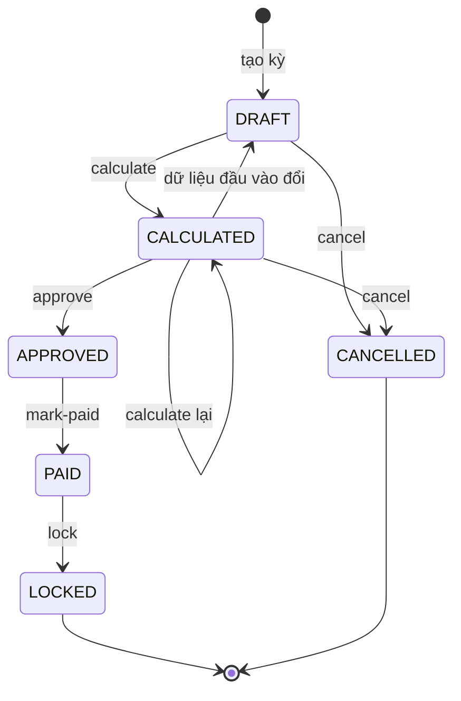

# Vòng đời kỳ lương

Tài liệu giải thích kỳ lương đi qua những trạng thái nào, ai được chuyển trạng thái, và hệ thống giữ phiếu lương
đúng thế nào khi dữ liệu đầu vào thay đổi. Công thức tính và request/response nằm ở
[PAYROLL.md](../api/PAYROLL.md).

## 1. Trạng thái

Mỗi tháng chỉ có một kỳ chưa hủy. `CANCELLED` và `LOCKED` là trạng thái cuối. Kỳ `APPROVED` trở đi **không có luồng
mở lại**.

## 2. Chuyển trạng thái

Mọi thao tác đều cần phạm vi `COMPANY` của permission tương ứng (`requireCompanyWide`) và khóa dòng kỳ lương bằng
`SELECT … FOR UPDATE` trước khi kiểm tra trạng thái.

| Thao tác | Permission | Từ | Điều kiện thêm |
|:---------|:-----------|:---|:---------------|
| Tạo kỳ | `payroll.calculate` | — | Tháng đó chưa có kỳ nào khác `CANCELLED` |
| `calculate` | `payroll.calculate` | `DRAFT`, `CALCULATED` | Phải có `taxPaymentDate` (ngày trả lương dự kiến); không kỳ nào khác đã tính có cùng **tháng trả lương** |
| `approve` | `payroll.approve` | `CALCULATED` | Người duyệt **khác** người tính; không có bản ghi chấm công trong kỳ được sửa sau lúc tính |
| `mark-paid` | `payroll.mark_paid` | `APPROVED` | Ngày trả thực tế (mặc định hôm nay theo giờ Việt Nam) phải cùng tháng với `taxPaymentDate` |
| `lock` | `payroll.lock` | `PAID` | — |
| `cancel` | `payroll.calculate` | `DRAFT`, `CALCULATED` | — |

Lý do của các điều kiện:

- **Một kỳ cho mỗi tháng trả lương:** thuế TNCN tính theo tháng nhận thu nhập; hai kỳ trả cùng tháng thì phải tính
  thuế gộp, hệ thống chưa hỗ trợ nên chặn luôn.
- **Người duyệt khác người tính** (four-eyes): một người không tự tính rồi tự duyệt lương.
- **Tháng trả thực tế phải khớp:** thuế đã tính theo `taxPaymentDate`; trả lệch tháng thì số thuế có thể sai.

## 3. Tính lương

`PayrollService.calculate`:

1. Xóa toàn bộ phiếu lương cũ của kỳ (tính lại là tính từ đầu).
2. Lấy mọi nhân viên có làm việc trong kỳ (`findEmployedDuring`), kể cả người vào làm hoặc nghỉ việc giữa tháng.
3. Tính từng người. Thiếu bất kỳ dữ liệu nào (phân công chính, ca làm, lương cơ bản, chấm công, ngày còn
   `MISSING_PUNCH`…) thì ném lỗi **cho cả kỳ**, ghi rõ mã nhân viên và dữ liệu thiếu. Transaction rollback nên kỳ
   không bao giờ chỉ được tính một phần.
4. Chuyển kỳ sang `CALCULATED`, ghi người tính và thời điểm tính.

Phiếu lương lưu **snapshot** (mã, tên, đơn vị, địa điểm, căn cứ bảo hiểm, thuế, thực nhận…), nên phiếu đã tính
không đổi khi hồ sơ nhân viên đổi sau đó.

## 4. Thay đổi dữ liệu hồi tố

Khi dữ liệu đầu vào thay đổi với ngày hiệu lực nằm trong một kỳ đã tính, hệ thống xử lý như sau:

| Dữ liệu thay đổi | Kỳ `CALCULATED` | Kỳ `APPROVED` / `PAID` / `LOCKED` | Code |
|:-----------------|:----------------|:----------------------------------|:-----|
| Lương cơ bản | Về `DRAFT`, xóa phiếu | Chặn `409 PAYROLL_PERIOD_LOCKED` | `EmployeeSalaryHistoryService.setSalary` |
| Hồ sơ bảo hiểm/thuế của nhân viên | Về `DRAFT`, xóa phiếu | Chặn | `PayrollDeductionsService.setProfile` |
| Người phụ thuộc (thêm, kết thúc) | Về `DRAFT` (xét theo tháng trả lương) | Chặn | `PayrollDeductionsService.addDependent`, `endDependent` |
| Khoản cộng/trừ nhập tay | Về `DRAFT` | Chỉ thêm/xóa được khi kỳ `DRAFT` hoặc `CALCULATED` | `PayrollAdjustmentService` |
| Ngày lễ công ty | Về `DRAFT` | Chặn | `CompanyHolidayService` |
| Chấm công (gồm do duyệt đơn nghỉ, tăng ca) | **Không** về `DRAFT`, nhưng `approve` bị chặn tới khi tính lại | Chặn sửa | `AttendanceService.assertAttendanceEditable`, `PayrollService.approve` |
| Phụ cấp chức vụ / thâm niên, phân công, ca làm | **Không kiểm tra** | **Không kiểm tra** | Xem mục 6 |

Quy tắc thuế TNCN và bảo hiểm (bậc thuế, tỉ lệ, trần) **không sửa được qua API**; chúng được nạp bằng migration và
seeder.

"Kỳ bị ảnh hưởng" là các kỳ có `period_end >= ngày hiệu lực` (riêng người phụ thuộc: các kỳ có `taxPaymentDate`
trong khoảng hiệu lực). Các kỳ này được khóa `FOR UPDATE` theo thứ tự `period_start` để hai giao dịch không khóa
chéo nhau.

## 5. Ai xem được phiếu lương

| Người xem | Thấy gì |
|:----------|:--------|
| Có `report.payroll.read` (phạm vi `COMPANY`) | Mọi kỳ và mọi phiếu, ở mọi trạng thái |
| Chỉ có `payroll.self.read` | Phiếu của chính mình, **chỉ khi kỳ đã `APPROVED`, `PAID` hoặc `LOCKED`** |

## 6. Giới hạn hiện tại

- Không mở lại được kỳ `APPROVED` trở đi. Muốn sửa phải xử lý ngoài hệ thống hoặc bằng khoản điều chỉnh ở kỳ sau.
- Đổi quy tắc phụ cấp, phân công chính hoặc ca làm với ngày hiệu lực lùi về quá khứ **không** đưa kỳ đã tính về
  `DRAFT` và **không** bị chặn ở kỳ đã duyệt. Phiếu đã tính không đổi (nhờ snapshot), nhưng có thể không còn khớp
  với dữ liệu mới; tính lại kỳ `CALCULATED` sẽ ra số khác.

## Code

- [`PayrollService`](../../src/main/java/com/htttdn/hrm/service/PayrollService.java): `createPeriod`, `calculate`,
  `approve`, `markPaid`, `lock`, `cancel`
- [`PayrollDeductionsService`](../../src/main/java/com/htttdn/hrm/service/PayrollDeductionsService.java): `invalidate`
- [`EmployeeSalaryHistoryService`](../../src/main/java/com/htttdn/hrm/service/EmployeeSalaryHistoryService.java): `setSalary`
- [`PayrollPeriodRepository`](../../src/main/java/com/htttdn/hrm/repository/PayrollPeriodRepository.java): các truy vấn `…ForUpdate`
