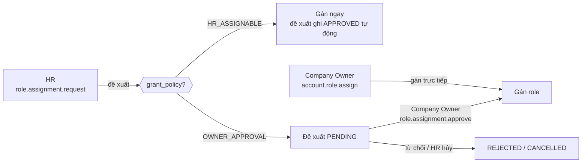

# Chính sách cấp role

Tài liệu giải thích **ai được cấp role nào cho ai, qua đường nào**. Danh sách permission của từng role nằm ở ma trận
trong [RBAC.md](../api/RBAC.md); phạm vi dữ liệu của một lần gán nằm ở [DATA_SCOPE.md](./DATA_SCOPE.md).

## 1. Hai thuộc tính quyết định

| Thuộc tính | Gắn với | Giá trị | Ý nghĩa |
|:-----------|:--------|:--------|:--------|
| `assignment_policy` | Permission | `DELEGABLE`, `SYSTEM_ONLY` | Permission có được đưa vào **custom role** không. `SYSTEM_ONLY` chỉ seeder gán cho system role |
| `grant_policy` | Role | `AUTO`, `HR_ASSIGNABLE`, `OWNER_APPROVAL`, `SYSTEM_ONLY` | Role được **cấp cho account** qua workflow nào |

`grant_policy` không phải cấp bậc và không tạo quan hệ cha con giữa các role.

## 2. System role

| Role | `grant_policy` | Scope cho phép | Được cấp thế nào |
|:-----|:---------------|:---------------|:-----------------|
| `EMPLOYEE` | `AUTO` | `SELF` (khi tự gán) | Tự gán với scope `SELF` khi cấp account cho nhân viên |
| `MANAGER` | `HR_ASSIGNABLE` | `ORG_UNIT`, `LOCATION` | HR đề xuất là có hiệu lực ngay |
| `HR_MANAGER` | `OWNER_APPROVAL` | `COMPANY` | HR đề xuất, Company Owner duyệt |
| `PAYROLL_ACCOUNTANT` | `OWNER_APPROVAL` | `COMPANY` | HR đề xuất, Company Owner duyệt |
| `PAYROLL_APPROVER` | `OWNER_APPROVAL` | `COMPANY` | HR đề xuất, Company Owner duyệt |
| `DIRECTOR` | `OWNER_APPROVAL` | `COMPANY` | HR đề xuất, Company Owner duyệt; hoặc gán lúc khởi tạo doanh nghiệp |
| `COMPANY_OWNER` | `SYSTEM_ONLY` | `COMPANY` | Chỉ qua workflow khởi tạo doanh nghiệp của System Admin |
| `SYSTEM_ADMIN` | `SYSTEM_ONLY` | — | Chỉ seeder |

Scope cho phép của system role khai báo trong `RoleAssignmentPolicy.SYSTEM_ROLE_SCOPES`. Custom role (do Company Owner
tạo) nhận mọi scope.

## 3. Các đường cấp role

| Đường | Permission | Role được phép | Kiểm tra thêm |
|:------|:-----------|:---------------|:--------------|
| Đề xuất (`/api/role-assignment-requests`) | `role.assignment.request` (HR_MANAGER) | `HR_ASSIGNABLE`, `OWNER_APPROVAL` | Nhân viên đích và đơn vị/địa điểm của scope phải nằm trong phạm vi của HR; `effective_from` không trước ngày vào làm |
| Duyệt đề xuất | `role.assignment.approve` (COMPANY_OWNER) | `OWNER_APPROVAL` | Đề xuất phải còn `PENDING` |
| Gán trực tiếp (`/api/accounts/{id}/role-assignments`) | `account.role.assign` (COMPANY_OWNER) | `HR_ASSIGNABLE`, `OWNER_APPROVAL` | Guard bảo vệ Company Owner / System Admin (mục 5). System Admin không có permission này, nên không ai cấp role `OWNER_APPROVAL` mà không qua Company Owner |
| Khởi tạo doanh nghiệp | `organization.company_owner.bootstrap` (SYSTEM_ADMIN) | `COMPANY_OWNER`, `DIRECTOR` | Chỉ dùng một lần khi doanh nghiệp chưa có Company Owner |
| Cấp account cho nhân viên | `account.provision` | `EMPLOYEE` (`AUTO`) | — |

Mọi đường đều kiểm tra chung: account không `DISABLED`, account có liên kết nhân viên, scope hợp lệ với role, không
trùng lần gán đang có cùng role và scope trong khoảng thời gian chồng nhau (`ROLE_ASSIGNMENT_EXISTS`).

## 4. Thu hồi role

- **Đề xuất thu hồi:** HR chọn một lần gán đang hiệu lực của role `HR_ASSIGNABLE` hoặc `OWNER_APPROVAL`. Role
  `HR_ASSIGNABLE` bị thu hồi ngay; role `OWNER_APPROVAL` chờ Company Owner duyệt. Khi duyệt, hệ thống kiểm tra lại
  lần gán vẫn còn hiệu lực. Mỗi lần gán chỉ có tối đa một đề xuất thu hồi đang chờ.
- **Thu hồi trực tiếp:** người có `account.role.assign`.
- Role `AUTO` và `SYSTEM_ONLY` **không** thu hồi được qua các đường này; chúng do workflow riêng quản lý (ví dụ
  `EMPLOYEE` mất khi nhân viên nghỉ việc).
- Thu hồi đặt `revoked_at`, kéo `effective_to` về hôm nay và **thu hồi mọi refresh token** của account (xem
  [TOKEN_LIFECYCLE.md](./TOKEN_LIFECYCLE.md#6-khi-nào-mọi-phiên-bị-thu-hồi)).

## 5. Guard bảo vệ tài khoản cấp cao

`CompanyOwnerAccountGuard.requireCanManage(targetAccountId)`:

- Account đích đang giữ `COMPANY_OWNER` thì chỉ một Company Owner khác được thay đổi quyền truy cập của nó.
- Account đích đang giữ `SYSTEM_ADMIN` thì chỉ System Admin được thay đổi.

Guard áp cho gán/thu hồi role trực tiếp, đề xuất thu hồi, permission override và các thao tác vòng đời account (tạm ngưng, gửi lại lời
mời, reset mật khẩu, xóa). Mục đích: người có quyền quản lý account (ví dụ HR) không chiếm được tài khoản cấp cao
bằng cách reset mật khẩu hay tự cấp thêm role.

## 6. Permission override

Ngoài role, mỗi lần gán role có thể có override `GRANT` (cấp thêm) hoặc `REVOKE` (bớt đi) **một** permission, kèm
lý do và thời hạn. Cần `account.permission.override.manage` (`SYSTEM_ONLY`, chỉ Company Owner có). Tạo hoặc thu hồi
override đều thu hồi refresh token của account. Endpoint: [ACCOUNT_PERMISSION_OVERRIDES.md](../api/ACCOUNT_PERMISSION_OVERRIDES.md).

## Code

- [`RoleAssignmentPolicy`](../../src/main/java/com/htttdn/hrm/service/RoleAssignmentPolicy.java): scope cho phép của từng role
- [`AccountRoleAssignmentCommandService`](../../src/main/java/com/htttdn/hrm/service/AccountRoleAssignmentCommandService.java): `validateGrantPolicy`, `revoke`
- [`RoleAssignmentRequestService`](../../src/main/java/com/htttdn/hrm/service/RoleAssignmentRequestService.java): `create`, `createRevocation`, `approve`
- [`CompanyOwnerAccountGuard`](../../src/main/java/com/htttdn/hrm/service/CompanyOwnerAccountGuard.java)
- Seed: [`RoleSeeder`](../../src/main/java/com/htttdn/hrm/config/seed/RoleSeeder.java), [`RolePermissionSeeder`](../../src/main/java/com/htttdn/hrm/config/seed/RolePermissionSeeder.java)
- Endpoint: [ACCOUNT_ROLE_ASSIGNMENTS.md](../api/ACCOUNT_ROLE_ASSIGNMENTS.md), [ROLE_ASSIGNMENT_REQUESTS.md](../api/ROLE_ASSIGNMENT_REQUESTS.md)
