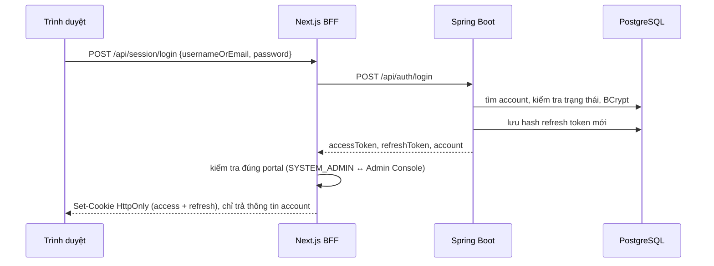
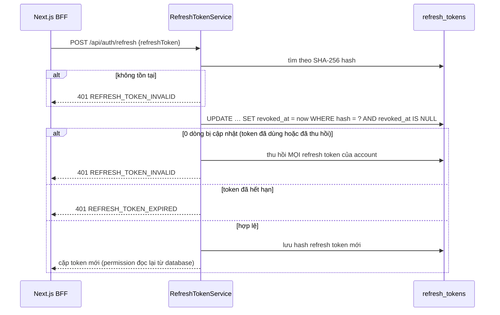

# Vòng đời token và phiên đăng nhập

Tài liệu giải thích các loại token, cách phiên đăng nhập được tạo, gia hạn và thu hồi. Request/response từng endpoint
nằm ở [AUTH.md](../api/AUTH.md); phía web (cookie, route BFF) nằm ở
[apps/web/docs/AUTH.md](../../../apps/web/docs/AUTH.md).

## 1. Ba loại token

| Token | Dạng | Thời hạn | Lưu ở đâu | Dùng để |
|:------|:-----|:---------|:----------|:--------|
| Access token | JWT ký HS256 | 15 phút (`JWT_ACCESS_TOKEN_EXPIRATION_SECONDS`) | Không lưu ở backend; web giữ trong cookie `HttpOnly` | Gọi API qua header `Authorization: Bearer` |
| Refresh token | Chuỗi ngẫu nhiên 64 byte (Base64 URL) | 30 ngày (`JWT_REFRESH_TOKEN_EXPIRATION_DAYS`) | Bảng `refresh_tokens`, **chỉ lưu SHA-256 hash** | Đổi lấy cặp token mới |
| Activation token | Chuỗi ngẫu nhiên | 24 giờ (`ACCOUNT_ACTIVATION_TOKEN_EXPIRATION_HOURS`) | Bảng activation token, **chỉ lưu hash** | Link mời: tự đặt mật khẩu lần đầu hoặc sau khi reset |

Claim của access token: `iss`, `sub` (username), `iat`, `exp`, `accountId`, `roles` (mã role) và `permissions`
(mã permission hiệu lực, gộp từ mọi lần gán role). JWT **không chứa phạm vi dữ liệu**; phạm vi được đọc từ database
ở mỗi request (xem [DATA_SCOPE.md](./DATA_SCOPE.md)).

Mỗi request, `NimbusJwtDecoder` kiểm tra chữ ký, thời hạn và `iss` khớp `JWT_ISSUER`, rồi chuyển `roles` thành
authority `ROLE_<code>` và `permissions` thành authority giữ nguyên mã.

## 2. Đăng nhập

`AuthService.login`:

- Chấp nhận username, email (đưa về chữ thường) hoặc mã nhân viên (không phân biệt hoa/thường), tìm theo đúng thứ tự đó.
- Account phải ở trạng thái `ACTIVE`. Account `DISABLED` nhập đúng mật khẩu thì nhận mã lỗi riêng; sai mật khẩu, hoặc
  account `PENDING` chưa có mật khẩu, đều nhận `INVALID_CREDENTIALS`.
- Sai mật khẩu thì tăng `failedLoginCount`, nhưng **hiện không tự khóa account** theo số lần sai. Đăng nhập đúng
  đặt bộ đếm về 0 và ghi `lastLoginAt`.
- Thành công thì tạo refresh token mới và ký access token từ snapshot role/permission tại thời điểm đó.

## 3. Refresh: xoay vòng và phát hiện dùng lại

- **Xoay vòng:** mỗi refresh token chỉ dùng được một lần.
- **Phát hiện dùng lại:** token đã thu hồi mà vẫn được gửi lên thì coi như bị lộ, nên mọi phiên của account bị thu hồi.
- **Chống chạy đồng thời:** câu `UPDATE … WHERE revoked_at IS NULL` là nguyên tử, nên khi hai request dùng cùng một
  token chỉ một request thắng; request còn lại rơi vào nhánh "dùng lại".
- `@Transactional(noRollbackFor = InvalidTokenException.class)` giữ việc thu hồi được commit dù request trả lỗi.
- Sau khi xoay vòng, account phải còn `ACTIVE`; nếu không, mọi refresh token của account bị thu hồi.

Vì cơ chế phát hiện dùng lại, client **không được gửi hai refresh song song**. Web gộp các lần refresh đồng thời
thành một (`refreshRequests` trong `apps/web/lib/auth/client.ts`).

## 4. Đăng xuất

`POST /api/auth/logout` thu hồi đúng refresh token của phiên hiện tại; các phiên ở thiết bị khác vẫn còn. Access
token đã cấp vẫn hợp lệ tới khi hết hạn; BFF xóa cookie nên trình duyệt không dùng lại được.

## 5. Kích hoạt tài khoản

1. Admin hoặc HR cấp account, hoặc yêu cầu reset mật khẩu: account ở trạng thái `PENDING`, hệ thống phát activation
   token mới và thu hồi token cũ còn hiệu lực của account đó. Chỉ phát được khi account đang `PENDING`.
2. Người nhận mở `/activate/<token>` và đặt mật khẩu (`POST /api/account-activations/{token}/complete`).
3. Backend khóa token bằng `SELECT … FOR UPDATE`, kiểm tra hạn và trạng thái, chuyển account sang `ACTIVE`, đánh dấu
   token đã dùng và thu hồi các activation token còn lại.

## 6. Khi nào mọi phiên bị thu hồi

`RefreshTokenService.revokeAll(accountId)` được gọi khi:

| Sự kiện | Code |
|:--------|:-----|
| Tự đổi mật khẩu | `AuthService.changePassword` |
| Admin reset mật khẩu (account về `PENDING`) | `AccountAdminService.initiatePasswordReset` |
| Tạm ngưng account (`DISABLED`) | `AccountAdminService.suspend` |
| Xóa mềm account | `AccountAdminService.delete` |
| Thu hồi một lần gán role | `AccountRoleAssignmentCommandService.revoke` |
| Tạo hoặc thu hồi permission override | `AccountPermissionOverrideService` |
| Nhân viên nghỉ việc (account bị `DISABLED`, role bị thu hồi) | `EmployeeService` (kết thúc làm việc) |
| Phát hiện refresh token bị dùng lại, hoặc account không còn `ACTIVE` khi refresh | `RefreshTokenService.rotate`, `AuthService.refresh` |

Thu hồi refresh token **không vô hiệu access token đang còn hạn**. Trong tối đa 15 phút đó, các permission cũ trong
JWT vẫn qua được `@PreAuthorize`; phạm vi dữ liệu thì đã đọc theo database mới. Khi access token hết hạn, refresh
thất bại và người dùng phải đăng nhập lại.

**Cấp thêm** role hoặc permission không thu hồi phiên: permission mới có trong JWT ở lần refresh tiếp theo (tối đa
15 phút) hoặc khi đăng nhập lại.

## 7. Phía web (BFF)

- Access token và refresh token nằm trong cookie `HttpOnly`, `SameSite=Lax`, `Secure` ở production. Cookie access
  hết hạn cùng access token; cookie refresh sống 30 ngày (`AUTH_REFRESH_COOKIE_MAX_AGE_SECONDS`).
- Hai portal có bộ cookie riêng: `hrm_*` cho HRM Workspace, `hrm_admin_*` cho Admin Console.
- **Việc tách portal do BFF kiểm tra**, không phải backend: account có `SYSTEM_ADMIN` chỉ vào được Admin Console, account
  không có thì chỉ vào được HRM Workspace. Đăng nhập sai portal thì BFF thu hồi ngay phiên vừa tạo.
- Phần lớn route ghi của BFF từ chối request không phải `GET` có header `Origin` khác domain của web (kiểm tra
  trong từng hàm `handle…Request` của `lib/auth/server.ts`).

## 8. Cấu hình

| Biến môi trường | Mặc định | Ghi chú |
|:----------------|:---------|:--------|
| `JWT_SECRET` | có giá trị dev trong `application.properties` | Base64, tối thiểu 32 byte sau khi decode. **Bắt buộc đặt riêng ở production** |
| `JWT_ISSUER` | `https://hrm.local` | Decoder từ chối token có `iss` khác |
| `JWT_ACCESS_TOKEN_EXPIRATION_SECONDS` | `900` | |
| `JWT_REFRESH_TOKEN_EXPIRATION_DAYS` | `30` | |
| `ACCOUNT_ACTIVATION_TOKEN_EXPIRATION_HOURS` | `24` | |

## Code

- [`AuthService`](../../src/main/java/com/htttdn/hrm/service/AuthService.java): `login`, `refresh`, `changePassword`
- [`RefreshTokenService`](../../src/main/java/com/htttdn/hrm/service/RefreshTokenService.java): `create`, `rotate`, `revokeAll`
- [`AccountActivationService`](../../src/main/java/com/htttdn/hrm/service/AccountActivationService.java)
- [`JwtService`](../../src/main/java/com/htttdn/hrm/security/JwtService.java),
  [`ApplicationConfig`](../../src/main/java/com/htttdn/hrm/config/ApplicationConfig.java) (encoder, decoder, chuyển claim thành authority)
- Web: [`apps/web/lib/auth/server.ts`](../../../apps/web/lib/auth/server.ts), [`apps/web/lib/auth/client.ts`](../../../apps/web/lib/auth/client.ts)
