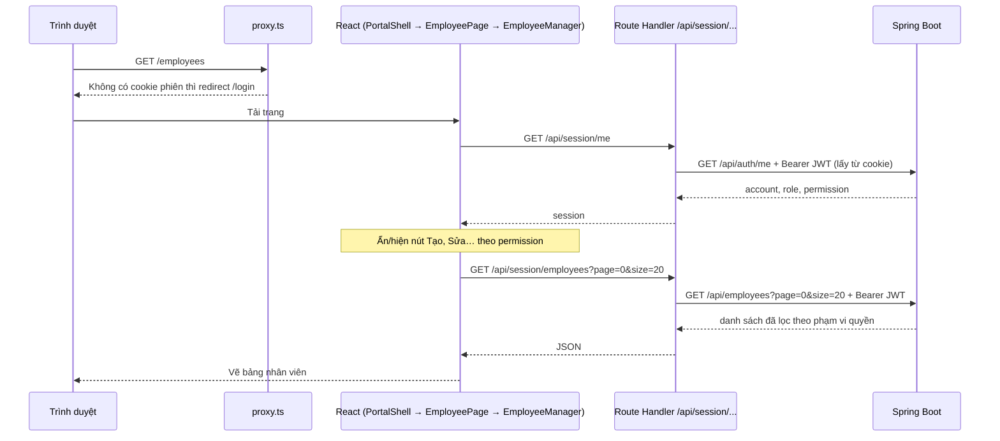

# Kiến trúc frontend (đọc từ góc nhìn backend)

Tài liệu này giải thích web Next.js được chia thư mục thế nào và một request đi qua những đâu, bằng cách đối
chiếu với các khái niệm quen thuộc bên Spring Boot. Chi tiết về cookie, session endpoint và envelope nằm ở
[AUTH.md](./AUTH.md); lệnh chạy và kiểm tra nằm ở [DEVELOPMENT.md](./DEVELOPMENT.md).

## 1. Hai nửa của ứng dụng

Ứng dụng Next.js này có hai nửa chạy ở hai nơi:

| Nửa | Chạy ở đâu | Nhiệm vụ | Tương đương bên backend |
|:----|:-----------|:---------|:------------------------|
| Giao diện (React component) | Trình duyệt | Vẽ màn hình, nhận thao tác, gọi BFF | Không có, đây là phần UI |
| BFF (Route Handlers trong `app/api/`) | Server Next.js (Vercel) | Giữ JWT trong cookie, chuyển request sang Spring Boot | Một API Gateway nhỏ |

**Trình duyệt không gọi thẳng Spring Boot.** Nó gọi `/api/session/...` (hoặc `/api/admin-session/...`) của chính
Next.js; Route Handler đọc access token từ cookie `HttpOnly`, gắn `Authorization: Bearer …` rồi gọi API. JavaScript
trên trình duyệt không bao giờ đọc được JWT.

## 2. Cấu trúc thư mục

```text
apps/web/
├── proxy.ts              "Filter" chạy trước các trang: không có cookie phiên thì redirect về trang đăng nhập
├── app/                  ROUTING: mỗi thư mục là một đoạn URL
│   ├── page.tsx              /            chuyển về /dashboard (chưa đăng nhập thì về /login)
│   ├── login/                /login       đăng nhập HRM Workspace
│   ├── activate/             /activate    kích hoạt tài khoản từ link mời
│   ├── (hrm)/                nhóm trang HRM Workspace; "(…)" không xuất hiện trên URL
│   │   ├── layout.tsx            khung chung: PortalShell (kiểm tra phiên + sidebar)
│   │   ├── employees/page.tsx    /employees
│   │   └── …                     /payroll, /attendance, /reports, …
│   ├── admin/                Admin Console: /admin/login, /admin/…
│   └── api/                  BFF (Route Handlers), không phải trang
│       ├── session/…             API cho HRM Workspace
│       ├── admin-session/…       API cho Admin Console
│       └── account-activations/… kích hoạt tài khoản (không cần đăng nhập)
├── components/           UI, chia theo domain
│   ├── employee/, payroll/, rbac/, report/, …
│   ├── portal/               portal-shell (phiên + khung), sidebar, page-header
│   ├── common/               bộ lọc, phân trang, menu "…" dùng chung
│   └── ui/                   nút, bảng, dialog, input… (shadcn/ui)
└── lib/                  Logic không có giao diện
    ├── employee.ts, account.ts, …  hàm gọi BFF theo domain
    ├── auth/client.ts              fetch phía trình duyệt, tự refresh khi gặp UNAUTHORIZED
    ├── auth/server.ts              logic BFF: đọc cookie, gắn Bearer, gọi Spring Boot
    ├── auth/config.ts              cấu hình hai portal (tên cookie, prefix BFF, trang đăng nhập)
    ├── api-helpers.ts              đổi mã lỗi API sang câu tiếng Việt
    └── api-schema.ts               TypeScript type sinh từ OpenAPI của backend (không sửa tay)
```

Đối chiếu với backend:

| Frontend | Tương đương backend |
|:---------|:--------------------|
| [`proxy.ts`](../proxy.ts) | Security filter, nhưng chỉ kiểm tra có cookie phiên hay không |
| `app/**/page.tsx` | Endpoint `@GetMapping`: mỗi file là một URL, thường chỉ render một component |
| `app/**/layout.tsx` | Phần bọc chung cho mọi trang con (như một filter + template) |
| `components/<domain>/` | Controller + view: nhận thao tác người dùng và hiển thị |
| `lib/<domain>.ts` | Service phía client: gói các lời gọi API của domain |
| `app/api/**/route.ts` + [`lib/auth/server.ts`](../lib/auth/server.ts) | API Gateway: xác thực, whitelist đường dẫn, chuyển tiếp |
| [`lib/api-schema.ts`](../lib/api-schema.ts) | DTO, sinh từ Swagger bằng `npm run gen:api` |
| `components/ui/` | Thư viện component dùng chung |

## 3. Luồng mở trang "Nhân sự"



Đi theo code:

1. [`app/(hrm)/employees/page.tsx`](../app/%28hrm%29/employees/page.tsx) chỉ render `<EmployeePage />`.
2. [`app/(hrm)/layout.tsx`](../app/%28hrm%29/layout.tsx) bọc mọi trang HRM bằng `PortalShell`
   ([`components/portal/portal-shell.tsx`](../components/portal/portal-shell.tsx)). `PortalShell` gọi
   `/api/session/me` để lấy phiên; nếu nhận 401/403 thì chuyển về `/login`. Trong lúc chờ, trang hiện
   "Đang xác minh phiên đăng nhập...".
3. [`components/employee/employee-page.tsx`](../components/employee/employee-page.tsx) đọc permission của phiên
   để quyết định hiện nút nào. Đây **chỉ là ẩn/hiện giao diện**; quyền thật vẫn do backend kiểm tra bằng
   `@PreAuthorize` và phạm vi dữ liệu.
4. `EmployeeManager` gọi `employeeRequest()` trong [`lib/employee.ts`](../lib/employee.ts), hàm này gọi
   `authorizedRequest()` trong [`lib/auth/client.ts`](../lib/auth/client.ts) → `fetch("/api/session/employees…")`.
5. Route Handler gọi `handleEmployeeRequest()` trong [`lib/auth/server.ts`](../lib/auth/server.ts): kiểm tra
   đường dẫn và method có trong whitelist, chặn request ghi từ origin lạ, lọc query param được phép, đọc access
   token từ cookie, gắn `Bearer` rồi gọi `/api/employees` của Spring Boot và trả nguyên envelope về trình duyệt.

## 4. Đăng nhập và refresh token

- **Đăng nhập:** form gửi `POST /api/session/login`. BFF gọi `/api/auth/login`, nhận access token và refresh
  token, lưu cả hai vào cookie `HttpOnly` rồi chỉ trả thông tin account cho trình duyệt.
- **Access token hết hạn (15 phút):** khi một request nhận lỗi `UNAUTHORIZED`, `authorizedRequest` gọi
  `/api/session/refresh` rồi thử lại **một lần**. Nếu refresh cũng thất bại, lỗi được ném ra và component đưa
  người dùng về trang đăng nhập.
- **Gộp refresh:** nhiều request cùng gặp `UNAUTHORIZED` một lúc sẽ dùng chung một lần refresh (`refreshRequests`
  trong `lib/auth/client.ts`). Điều này bắt buộc vì backend xoay vòng refresh token và coi việc gửi lại token cũ
  là token bị dùng lại, khi đó mọi phiên của account bị thu hồi.
- **Hai portal tách biệt:** HRM Workspace dùng cookie `hrm_*` và prefix `/api/session`; Admin Console dùng cookie
  `hrm_admin_*` và prefix `/api/admin-session` (xem [`lib/auth/config.ts`](../lib/auth/config.ts)).

## 5. Xử lý lỗi

API trả envelope `{ success, data, error: { code, message, field } }`. Frontend không hiện `message` tiếng Anh
của API mà tra `error.code` trong `ERROR_MESSAGES` của [`lib/api-helpers.ts`](../lib/api-helpers.ts) để lấy câu
tiếng Việt. Thêm mã lỗi mới bên backend thì nhớ thêm câu tương ứng ở đây.

## 6. Tra cứu nhanh

| Muốn biết | Xem ở đâu |
|:----------|:----------|
| Một URL hiển thị gì | `app/.../page.tsx`, rồi component nó render trong `components/` |
| Một nút gọi API nào | Hàm trong `lib/<domain>.ts`, rồi Route Handler trong `app/api/session/...` |
| BFF chuyển request sang endpoint backend nào | Hàm `handle…Request` tương ứng trong `lib/auth/server.ts` |
| Kiểu dữ liệu của response | `lib/api-schema.ts` (sinh lại bằng `npm run gen:api` khi API đổi) |
| File chạy ở đâu | Có `"use client"` ở đầu file: chạy trên trình duyệt. Route Handler và `lib/auth/server.ts`: chạy trên server |
| Trang mới cần bảo vệ đăng nhập | Thêm đường dẫn vào `HRM_PAGES` và `config.matcher` trong `proxy.ts` |
